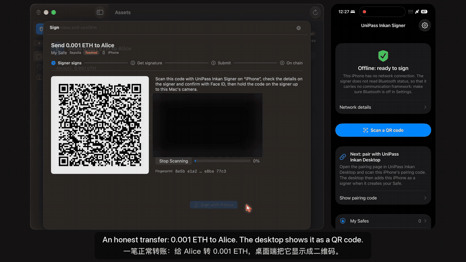
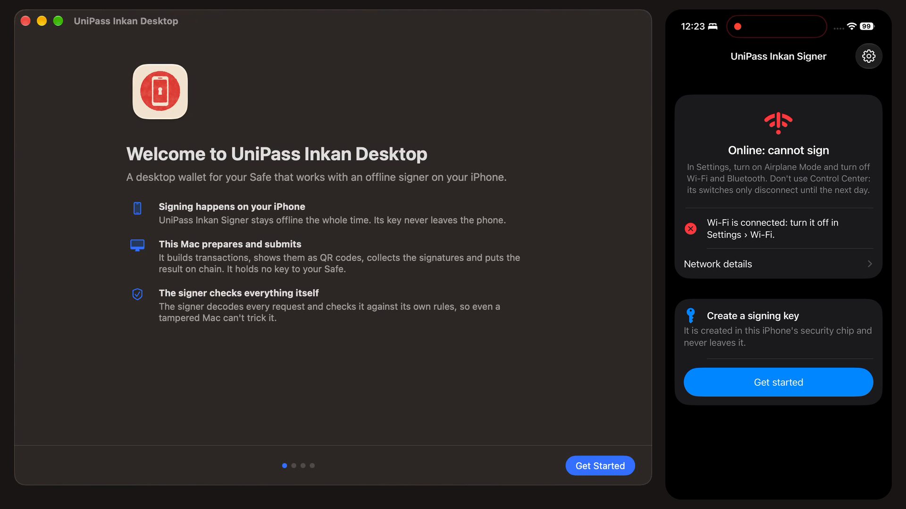
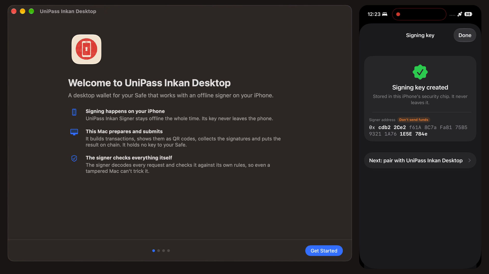
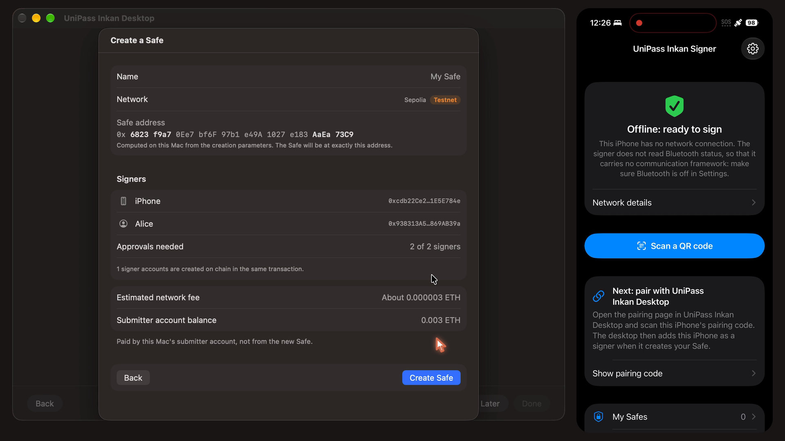
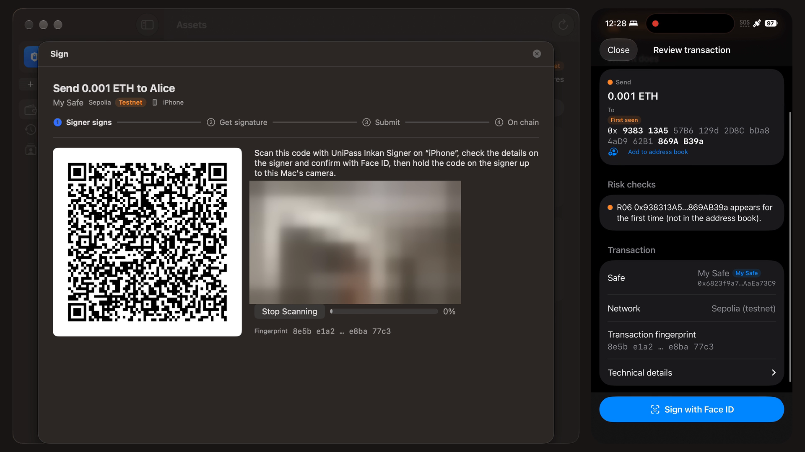
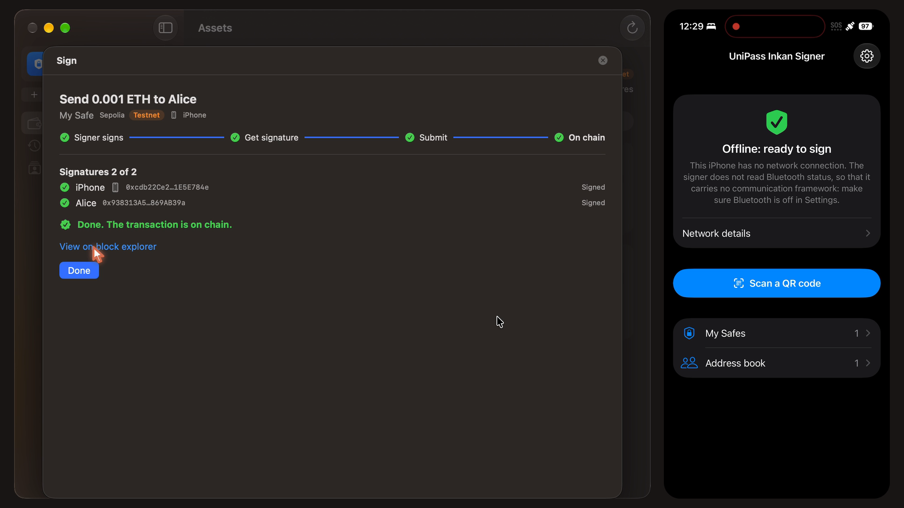
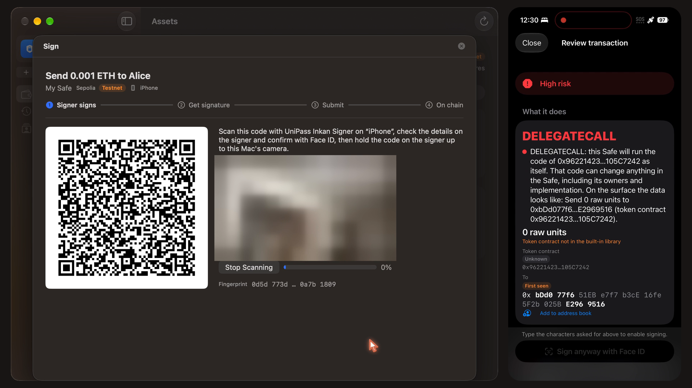
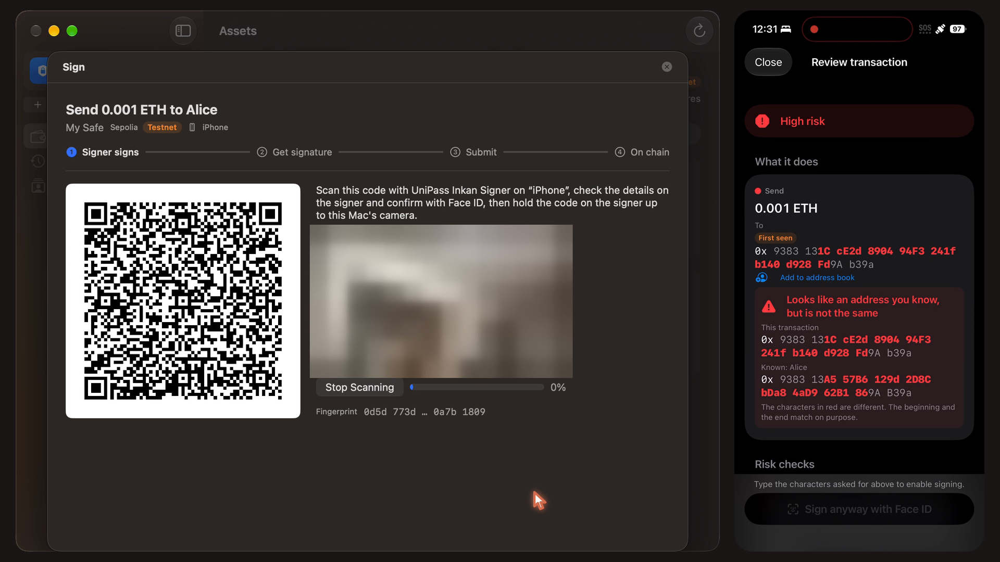
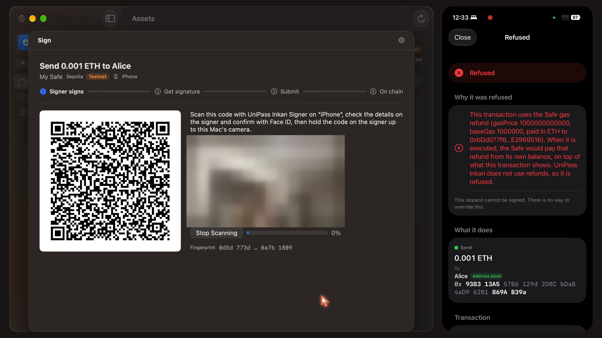

# UniPass Inkan

> [!CAUTION]
> **A proof of concept, not a product you can use.** It has had no external security audit, and there is no app store release and no prebuilt binary. Do not put real funds behind it. If you need something from it or have questions, [open an issue](https://github.com/zhixianio/unipass-inkan/issues); report security problems privately, see [SECURITY.md](SECURITY.md).

An offline iPhone becomes a hardware signer for your [Safe](https://safe.global): its Secure Enclave P-256 key is a Safe owner directly, and there is no seed phrase anywhere.

Mac desktop app on the left, offline iPhone signer on the right. Recorded on Sepolia; the camera previews are blurred. The Bybit-style step was recorded when it was a red warning; the signer now refuses it outright.

## What it does

- **The key cannot leave the phone.** The signing key is generated inside the iPhone's Secure Enclave and is not exportable. Safe accepts its signatures through Safe's own WebAuthn signer contracts, so nothing on chain is custom. The flip side is trusting Apple's random number generator: the key and the nonce of every signature are made inside the Secure Enclave, cannot be checked from outside, and cannot take your own entropy such as dice rolls. That is one reason the phone is meant to be one owner of a multisig, not the only one.
- **The phone reads the transaction itself.** Before asking for Face ID, the signer decodes the Safe transaction, recomputes its hash and checks it against Safe-specific risk rules: delegatecall, owner and threshold changes, MultiSend contents, unlimited approvals, address poisoning, gas-refund abuse. It refuses to sign a bare hash.
- **The computer is not trusted.** A Mac app builds transactions, collects signatures and submits them, but the signer never believes what it says. The two talk only through QR codes, and the signer refuses to sign while the phone has any network connection.
- **It catches the Bybit pattern.** Replaying the structure of the [February 2025 Bybit transaction](testvectors/rules/bybit-2025-02-21.json), where signers approved a hash their screens could not explain, is refused outright: a DELEGATECALL to anything other than Safe's own libraries cannot be signed.
- **The gas cost is small.** On chains with the P-256 precompile (Ethereum mainnet since Fusaka, EIP-7951; Base), an iPhone owner adds about 22k gas per transaction.

Evidence for each claim, with Sepolia transaction links: [docs/evidence.md](docs/evidence.md).

## Screenshots

| | |
|---|---|
|  |  |
| **Online: cannot sign.** With Wi-Fi on, the signer refuses and says what to turn off. | **Signing key created** in the Secure Enclave. The signer address is a contract; the app says not to send funds to it. |
|  |  |
| **Create a Safe** from the desktop app: this iPhone plus a second owner, address computed on the Mac, fee paid by the submitter account. | **An honest transfer.** The signer decodes it on its own and notes that Alice has not been seen before. |
|  |  |
| **On chain** after both owners sign; the submitter account pays the network fee. | **Attack 1, Bybit-style.** The tampered Mac still shows "Send 0.001 ETH to Alice"; the signer finds a DELEGATECALL to an unknown contract. (Recorded when this was a red warning; the signer now refuses it outright.) |
|  |  |
| **Attack 2, address poisoning.** The recipient matches Alice only at both ends; the signer marks every character that differs. | **Attack 3, gas-refund drain.** Hidden refund fields would pay the attacker from the Safe; the signer refuses, with no way to sign anyway. |

How to run the same demo: [docs/demo.md](docs/demo.md).

## Roadmap

| Status | Item |
|---|---|
| **Works today** | iPhone signer (offline, Secure Enclave) and Mac desktop app. Creating a Safe from the desktop app (or adding an existing one that meets the signer's conditions), offline signing over QR codes, Safe-aware risk rules on the phone, execution through a small desktop-held submitter account. Ethereum mainnet and Base are supported: every contract it relies on is already deployed there. The full flow has been tested end to end only on Sepolia. |
| **Next** | Replacing a signer, adding one or changing the threshold from the desktop app (for example after losing a phone), and exporting the Safe list to move to another Mac. Today these need Safe{Wallet}; the signer already shows owner changes as a before/after comparison. |
| **Designed, not built** | On-chain Guard: delegatecall only to Safe's MultiSendCallOnly, a waiting period before configuration changes, and a veto by any single owner. [docs/guard-design.md](docs/guard-design.md) |
| **Planned** | Pixel signer (StrongBox with key attestation, so iPhone and Pixel can form a cross-vendor multisig). [docs/future-work.md](docs/future-work.md) |
| **Planned** | YubiKey as a long-term backup owner, signing through the phone over NFC. |
| **Planned** | Paying gas from the Safe's own balance (ERC-4337). A Sepolia experiment worked; not adopted for now. |
| **Idea, not researched** | Migrating to a post-quantum owner (ML-DSA). |

Details on the planned items: [docs/future-work.md](docs/future-work.md).

## Build it yourself

There are no prebuilt apps. You need:

- a Mac with Xcode 27 and [XcodeGen](https://github.com/yonaskolb/XcodeGen), running macOS 26 for the desktop app;
- an iPhone on iOS 26 with a passcode and Face ID set up;
- a **paid** Apple Developer Program membership. A free account's install expires after 7 days; a paid one lasts about a year, after which you reinstall over the old app (the key and your Safes are kept).

Then follow:

1. [apps/signer/BUILDING.md](apps/signer/BUILDING.md): build the signer, check that the binary contains no network code, install it, and take the phone offline. The first launch after each install needs the internet once (an Apple requirement for developer-signed apps).
2. [apps/coordinator/README.md](apps/coordinator/README.md): build the Mac app, pair it with the signer, fund the submitter account, and create a Safe.

## More

- [docs/](docs/README.md): specs (signature format, QR protocol, decoding, risk rules), on-chain evidence, the demo script and future work. Mostly in Chinese.
- Security reports: [SECURITY.md](SECURITY.md).
- License: [Apache-2.0](LICENSE). Two files embed bytecode compiled from safe-modules and keep its LGPL-3.0-only license; third-party test data and dependencies keep their own. See [NOTICE](NOTICE).
